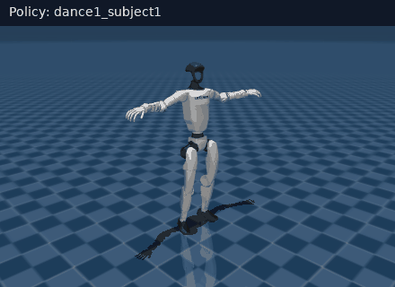
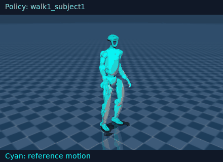
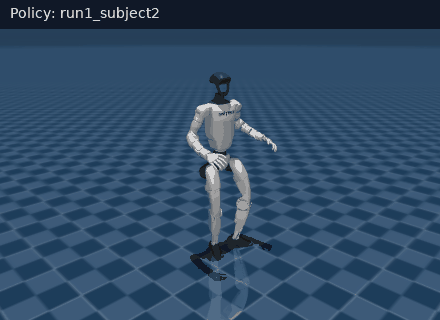
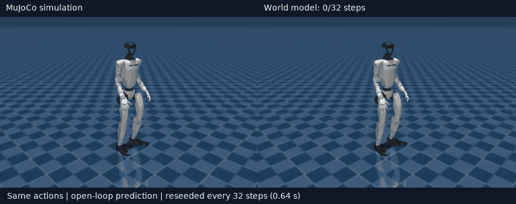
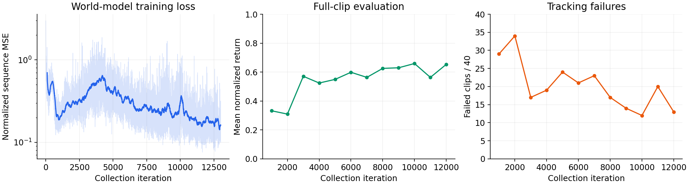

# SuperMimic in JAX

An independent, work-in-progress reimplementation of [SuperMimic](https://supermimic.github.io/) in JAX for humanoid motion imitation with a learned world model.

**WIP:** Training and motion tracking work, but there is still plenty to improve. Results are preliminary; this is not a verified reproduction of the paper's benchmarks. I’ll improve the implementation, training stability, and results over time.

## What's implemented

- Unitree G1 (29 DoF) tracking retargeted LAFAN1 motions in MuJoCo MJX with the Warp backend.
- Alternating simulator data collection, autoregressive world-model training, and policy optimization through differentiable imagined rollouts.
- Actor–critic training, domain randomization, adaptive motion reset sampling, checkpoint playback, and optional W&B logging.
- An experimental Koopman world-model variant alongside the MLP dynamics model.

The examples below use the MLP local-frame run: 256 parallel environments, an 8-step dynamics training window, and a 32-step imagination horizon at 50 Hz.

## Policy rollouts

Four-second excerpts from the iteration-12,000 checkpoint in native MuJoCo, with deterministic actions.

| Dance | Walk | Run |
| :---: | :---: | :---: |
|  |  |  |

## World-model predictions

Simulation on the left; learned dynamics on the right. Both receive the same policy actions. Each prediction starts from the simulator state, then runs open loop for 32 steps (0.64 seconds) before being reseeded. Shown at half speed to make drift easier to inspect.



## Training curves

Logged results from `g1_local_frame`. The world-model loss shows raw values and a 100-iteration moving average. Evaluation covers all 40 training motion clips, so these curves measure training-motion tracking rather than held-out generalization.



## Running it

The code uses JAX, Flax, Optax, MuJoCo/MJX with Warp, and Viser for interactive playback. Place the retargeted G1 LAFAN1 CSVs in `LAFAN1_Retargeting_Dataset/g1/`, then convert and train:

```bash
python convert_g1_to_npz.py
python train.py --preset local --iterations 1000 --run-dir runs/g1_local_frame
```

Play a checkpoint or inspect world-model predictions:

```bash
python scripts/view_checkpoint.py --checkpoint runs/g1_local_frame/latest.ckpt
python scripts/compare_model.py --checkpoint runs/g1_local_frame/latest.ckpt
```

Motion data and checkpoints are not included in this repository.

## Acknowledgments

Based on SuperMimic, using retargeted LAFAN1 motions and Unitree G1 assets. [Uni-SuperMimic](https://github.com/Motphys/Uni-SuperMimic) informed several implementation choices.
