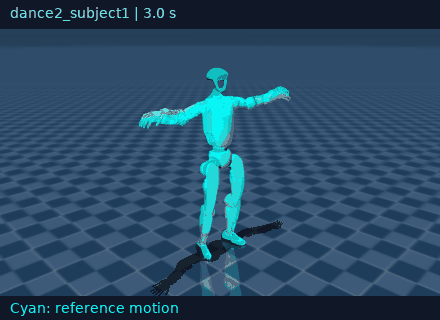
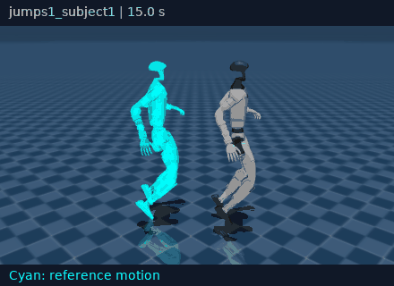
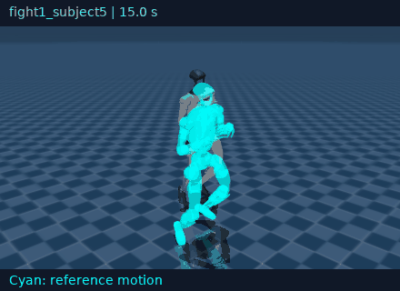
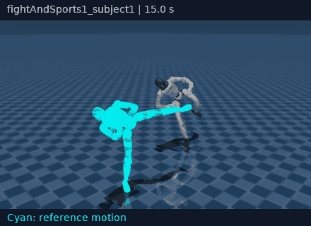
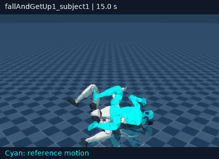
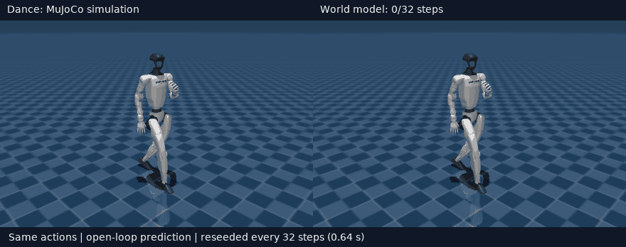
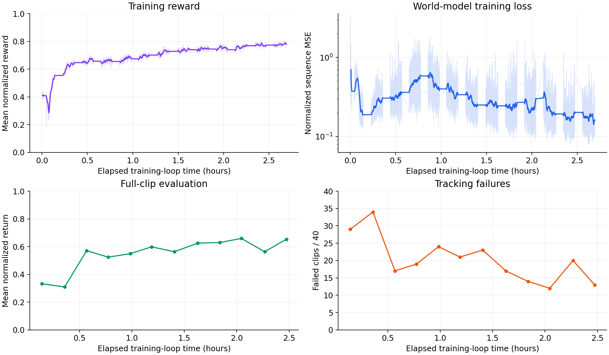

# SuperMimic in JAX

An independent, work-in-progress reimplementation of [SuperMimic](https://supermimic.github.io/) in JAX for humanoid motion imitation with a learned world model.

**WIP:** Training and motion tracking work, but there is still plenty to improve. Results are preliminary; this is not a verified reproduction of the paper's benchmarks. I’ll improve the implementation, training stability, and results over time.

## What's implemented

- Unitree G1 (29 DoF) tracking retargeted LAFAN1 motions in MuJoCo MJX with the Warp backend.
- Alternating simulator data collection, autoregressive world-model training, and policy optimization through differentiable imagined rollouts.
- Actor–critic training, domain randomization, adaptive motion reset sampling, checkpoint playback, and optional W&B logging.
- An experimental Koopman world-model variant alongside the MLP dynamics model.

The examples below use the MLP local-frame run on **one NVIDIA GeForce RTX 3090 (24 GB VRAM)**: 256 parallel environments, an 8-step dynamics training window, and a 32-step imagination horizon at 50 Hz.

## Policy rollouts

Rollouts from the iteration-12,000 checkpoint in native MuJoCo, with deterministic actions. The cyan overlay shows the reference motion.

Each demo shows 30 continuous seconds without resets. Dance excerpts start three seconds into the clip; the other excerpts start at 15 seconds. These evaluate existing training motions; there is no held-out validation split in this run.

| Dance 1 · 30 seconds | Dance 2 · 30 seconds |
| :---: | :---: |
|  |  |

| Jumps · 30 seconds | Fighting · 30 seconds |
| :---: | :---: |
|  |  |

| Fighting/sports · 30 seconds | Fall-and-get-up · 30 seconds |
| :---: | :---: |
|  |  |

Fall-and-get-up tracking remains a work in progress. Any tracking failure is marked in the GIF; playback continues to show the resulting behavior.

## World-model predictions

Simulation on the left; learned dynamics on the right. Both receive the same policy actions. Each prediction starts from the simulator state, then runs open loop for 32 steps (0.64 seconds) before being reseeded. Shown at half speed to make drift easier to inspect.


The same comparison on a dance motion (`dance2_subject1`):



## Training curves

Logged results from `g1_local_frame` against wall-clock time on the RTX 3090. Reward and world-model loss show unsmoothed values and a 100-iteration moving average. Evaluation covers all 40 training motion clips, so these curves measure training-motion tracking rather than held-out generalization.



Time comes from the logged training-loop timer, which starts after initialization and warm-up. Evaluation points use the timestamp recorded just before that evaluation; prior evaluations and checkpoint saves count toward elapsed time.

## Running it

The code uses JAX, Flax, Optax, MuJoCo/MJX with Warp, and Viser for interactive playback. Install a CUDA-enabled build of JAX for your system, then install the dependencies:

```bash
pip install -r requirements.txt
```

Place the retargeted G1 LAFAN1 CSVs in `LAFAN1_Retargeting_Dataset/g1/`, then convert and train:

```bash
python convert_g1_to_npz.py
python train.py --preset local --iterations 1000 --run-dir runs/g1_local_frame
```

Play a checkpoint or inspect world-model predictions:

```bash
python scripts/view_checkpoint.py --checkpoint runs/g1_local_frame/latest.ckpt
python scripts/compare_model.py --checkpoint runs/g1_local_frame/latest.ckpt
```

Motion data and checkpoints are not included in this repository.

The training entry point is [train.py](train.py); presets are in [train_config.py](train_config.py). Run the CPU tests with:

```bash
JAX_PLATFORMS=cpu python -m unittest discover -s tests
```

## Acknowledgments

Based on SuperMimic, using retargeted LAFAN1 motions and Unitree G1 assets.
